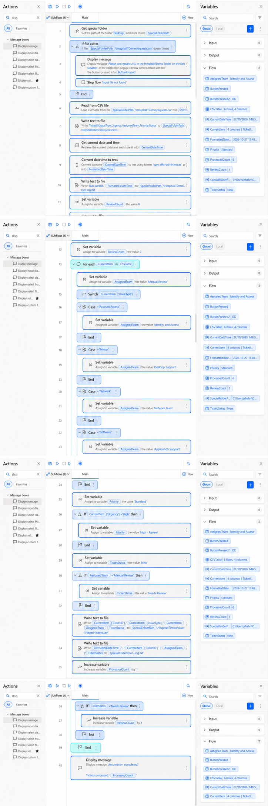
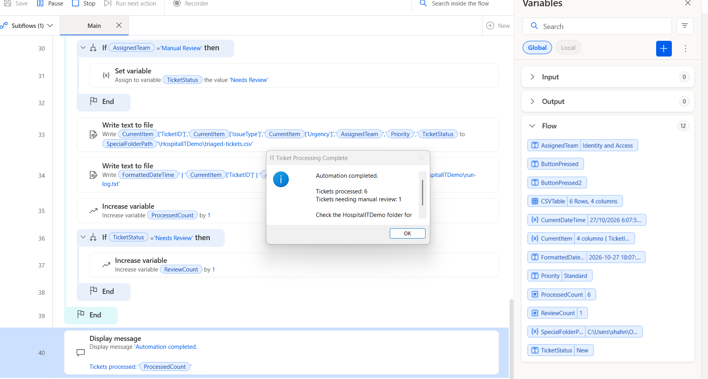
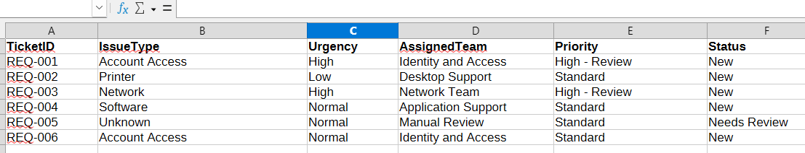

# Hospital IT Support Ticket Automation

**A beginner-friendly Microsoft Power Automate Desktop (PAD) portfolio project using fictional IT support requests.** This is a personal learning project—not an application created for, connected to, or endorsed by any hospital.

## Start here (reviewers)

**What does it do?** It reads six sample tickets from a CSV file, assigns a suggested IT support team based on issue type, marks high-urgency tickets for priority review, flags unmatched issue types for manual handling, writes results and logs its actions.

**Quick review, no installation required:**

1. [View sample incoming tickets](requests.csv).
2. [View the routing results](triaged-tickets.csv) and [compare expected results](expected-results.csv).
3. [View the activity log](run-log.txt).
4. [See the desktop flow](Flow-Design.png) or [read its exact actions](flow-actions.txt).
5. [Read test evidence and limitations](test-results.md).

**Want to run it yourself?** Follow [Run the demo on Windows](#run-the-demo-on-windows). **Want a visual walkthrough?** See [Screenshots and demo guide](#screenshots-and-demo-guide).

> **Demo status:** The repository contains screenshots and sample output from an earlier run, but it does **not** currently contain a recorded video of a fresh run. GitHub hosts the files; it cannot execute this Windows PAD flow in the browser.

## What problem does it illustrate?

In a fictional hospital IT service desk, incoming tickets might need repeatable categorisation. This demo illustrates how simple, predefined rules could help with triage while unknown issues remain for a person to review.

**Technology:** Microsoft Power Automate Desktop, Windows, CSV files, local text-file logging.

**Scope:** Local and manually initiated. No live service desk, patient or staff records, clinical systems, APIs, email, Power Apps, Dataverse or cloud-based triggers.

## Example: input → rules → output

| Input ticket | Issue type | Urgency | Suggested team | Priority | Status |
|---|---|---|---|---|---|
| REQ-001 | Account Access | High | Identity and Access | High - Review | New |
| REQ-002 | Printer | Low | Desktop Support | Standard | New |
| REQ-003 | Network | High | Network Team | High - Review | New |
| REQ-004 | Software | Normal | Application Support | Standard | New |
| REQ-005 | Unknown | Normal | Manual Review | Standard | Needs Review |
| REQ-006 | Account Access | Normal | Identity and Access | Standard | New |

**Key distinction:** Two tickets have a *High - Review priority*, but only **one** has *Needs Review status*. In this implementation, the manual-review counter increases only for unknown issue types, not for high-urgency tickets.

Routing rules are fictional examples—not any hospital's real IT policies.

## How the automation works

1. Checks for the file \`Desktop\HospitalITDemo\requests.csv\`. If missing, shows a warning and exits.
2. Reads CSV rows into a PAD data table.
3. Creates/overwrites \`triaged-tickets.csv\` and \`run-log.txt\`.
4. Loops through tickets, using exact text matching on \`IssueType\`:
   - \`Account Access\` → \`Identity and Access\`
   - \`Printer\` → \`Desktop Support\`
   - \`Network\` → \`Network Team\`
   - \`Software\` → \`Application Support\`
   - other values → \`Manual Review\`
5. Sets \`Priority\` to \`High - Review\` when \`Urgency\` is \`High\`; otherwise \`Standard\`.
6. Sets \`Status\` to \`Needs Review\` for unmatched issues; otherwise \`New\`.
7. Appends one output and log record for each ticket, then displays ticket counts.

**The actual PAD action export:** [flow-actions.txt](flow-actions.txt). This is text copied from the existing desktop flow, not a standalone executable or hosted web application.

## Run the demo on Windows

**Prerequisites**

- A Windows PC with **Microsoft Power Automate Desktop** installed and access to its flow designer.
- The ability to create a local folder and run a desktop flow.
- These repository files: [requests.csv](requests.csv) and [flow-actions.txt](flow-actions.txt).
- Optional: Python 3 to verify the checked-in example files (not required to run PAD).

**Step 1 — Set up the folder**

Create a folder named \`HospitalITDemo\` on your Windows Desktop. Save the downloaded \`requests.csv\` into it with that exact filename (avoid \`requests.csv.txt\`).

Your folder should look like:

\`\`\`text
Desktop/
└── HospitalITDemo/
    └── requests.csv
\`\`\`

**Step 2 — Set up the PAD flow**

If you are the project author, open the existing ticket automation flow in Power Automate Desktop.

If reproducing it on another Windows PC, create a new desktop flow and use [flow-actions.txt](flow-actions.txt) as the reference for building the \`Main\` subflow. Depending on PAD version, the action text may be pasteable in the designer when copied without the \`flow-actions.txt\` title, \`FUNCTION Main_copy GLOBAL\`, and final \`END FUNCTION\` wrapper; if paste fails, recreate the actions in the designer. This text file is not a guaranteed portable installer. Confirm every action and expression after import.

The flow uses \`%SpecialFolderPath%\HospitalITDemo\...\`, where \`SpecialFolderPath\` comes from \`Get special folder → Desktop\`. If your Desktop is redirected, check that the actual folder path matches this location. Ensure \`requests.csv\` is not locked by another application before running.

**Step 3 — Run**

Save the flow and select **Run** inside the PAD designer. A successful run of the six provided inputs should display:

\`\`\`text
IT Ticket Processing Complete

Automation completed.

Tickets processed: 6
Tickets needing manual review: 1

Check the HospitalITDemo folder for results.
\`\`\`

**Step 4 — Inspect output**

The same \`HospitalITDemo\` folder should now include:

\`\`\`text
HospitalITDemo/
├── requests.csv          # Input
├── triaged-tickets.csv   # Output (replaced on each run)
└── run-log.txt           # Activity log (replaced on each run)
\`\`\`

Open \`triaged-tickets.csv\`: compare to [expected-results.csv](expected-results.csv). Open \`run-log.txt\`: check for a start time and one entry per ticket. The copy checked into GitHub is [here](triaged-tickets.csv); it will **not** update automatically when you run PAD on your computer.

**Step 5 — Try two more tests**

- **Repeatability:** Run again with the same input and check the output still has exactly six data rows, not twelve.
- **Missing input:** Temporarily rename \`requests.csv\` to \`requests-backup.csv\`, run again, and check the warning appears. Restore its original name afterwards.

Record actual findings in [test-results.md](test-results.md). These manual tests are not automatically proven by the repository file comparison.

## Screenshots and demo guide

Screenshots are saved in the **repository root**, so these links work directly:

### Flow design

### Completion dialog

### Example results

### How to record a 2-minute walkthrough

1. **0:00–0:20** — Explain the fictional IT service-desk problem.
2. **0:20–0:40** — Show six entries in \`requests.csv\`.
3. **0:40–1:05** — Walk through routing and priority logic in PAD.
4. **1:05–1:25** — Run the flow and show the completion dialog.
5. **1:25–1:50** — Open the generated CSV and activity log; highlight REQ-005.
6. **1:50–2:00** — Explain limitations and possible next steps.

Record with a Windows screen recorder, inspect for accidental personal information, and share a video link here **only after creating and publishing the recording**. There is currently no hosted live demo or video link.

## Verify the sample files without PAD

The checked-in output has been compared with the expected results: **six rows match**, two priority flags are present, one unmatched ticket needs manual review, and the log records all six tickets.

To reproduce these **file-level** checks, install Python 3, download/clone the full repository, open a terminal in its folder and run:

\`\`\`powershell
python verify_results.py
\`\`\`

See [verify_results.py](verify_results.py) and [test-results.md](test-results.md). Passing these tests **does not** prove that the Windows automation was freshly executed or that missing-file / repeat-run behaviour was observed.

## Current limitations and possible improvements

- Runs manually on one Windows machine; it is **not** a real-time service desk.
- Uses exact issue-type strings; different capitalisation or extra spaces may not match.
- Writes CSV rows by joining values, without full CSV quoting/escaping. Commas, quotes or newlines in input fields could make the output invalid.
- Basic missing-input validation is present, but comprehensive error handling, notifications and retries are not.
- Urgent priority is marked; there is no separate escalation status or notification.
- No Power Apps, Dataverse, enterprise connectors, deployment pipeline or access-control demonstration.

Logical future upgrades: robust CSV escaping and input validation; configuration-driven rules; structured test cases; a clear escalation workflow; and integration with approved enterprise tools, if access is available.

## Repository file guide

| File | Purpose |
|---|---|
| [README.md](README.md) | This reviewer and setup guide |
| [requests.csv](requests.csv) | Six **fictional** input tickets |
| [flow-actions.txt](flow-actions.txt) | Text representation of PAD actions |
| [triaged-tickets.csv](triaged-tickets.csv) | Sample output from an earlier run |
| [expected-results.csv](expected-results.csv) | Reference expected output |
| [run-log.txt](run-log.txt) | Example activity log |
| [verify_results.py](verify_results.py) | Offline checks of checked-in evidence |
| [test-results.md](test-results.md) | Evidence, unverified tests and manual test steps |
| [Flow-Design.png](Flow-Design.png) | Screenshot of the flow |
| [Completion.png](Completion.png) | Screenshot of completion message |
| [Results.png](Results.png) | Screenshot of sample output |

## Data, privacy and attribution

All input tickets are synthetic. Do not upload patient data, genuine employee information, credentials or other confidential records. This independent learning project was **not commissioned, sponsored, approved or reviewed by The Royal Women's Hospital** or any other hospital.
